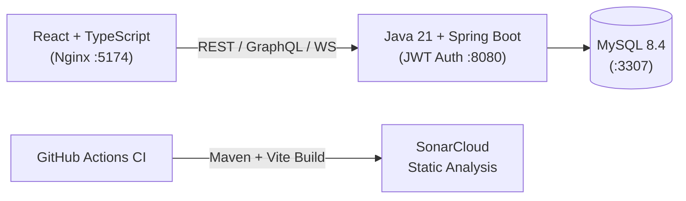

# Budget & Group Debt Management App (`PASJava-Sonar`)

[](https://github.com/mpecek2077/PASJava-Sonar/actions/workflows/sonar.yml)

Full-stack web application for tracking personal income/expenses and settling shared group debts. Built with a **Java 21 / Spring Boot** backend (REST + GraphQL APIs and real-time WebSocket notifications) and a **React / TypeScript** frontend, containerized with Docker Compose and integrated with automated CI/CD static analysis in **SonarCloud**.

## Architecture



## Key Features

- **Authentication & Security:** User registration and login secured with Spring Security and stateless **JWT** tokens (`JwtAuthFilter`).
- **Personal Budget Tracking:** Adding, categorizing, and filtering income and expense transactions with real-time balance calculation.
- **Group Expense Splitting & Debts:** Creating groups, managing memberships, logging shared group transactions, and automatically calculating member balances and debts.
- **Real-Time Notifications:** Live updates for group activities delivered via **WebSockets** (`WebSocketConfig`, `NotificationService`).
- **Hybrid API Architecture:** REST endpoints for authentication and core transactions alongside a **GraphQL** schema (`schema.graphqls`) for flexible querying of groups, memberships, and debts.
- **Automated Quality Gates:** Push and pull request events trigger a **GitHub Actions** pipeline (`.github/workflows/sonar.yml`) running backend/frontend builds and static code analysis in **SonarCloud**.

## Tech Stack

- **Backend:** Java 21, Spring Boot, Spring Security (JWT), Spring for GraphQL, WebSockets, Maven, MySQL 8.4
- **Frontend:** React, TypeScript, Vite, SCSS Modules, Axios, GraphQL Client
- **DevOps & Quality:** Docker, Docker Compose, Nginx, GitHub Actions, SonarCloud, JUnit

## Quick Start (Docker Compose)

1. Configure environment variables in `backend/.env` (MySQL credentials & JWT secret):
   ```env
   MYSQL_ROOT_PASSWORD=rootpassword
   MYSQL_DATABASE=budget_db
   MYSQL_USER=app_user
   MYSQL_PASSWORD=app_password
   JWT_SECRET=your-base64-jwt-secret
   ```
2. Build and start all services:
   ```bash
   docker compose up --build
   ```
3. Access the application:
   - **Frontend:** `http://localhost:5174`
   - **Backend API:** `http://localhost:8080`
   - **MySQL:** `localhost:3307`

## Running Backend Tests

```bash
cd backend
mvn test
```

## Project Structure

```text
PASJava-Sonar/
├── .github/workflows/
│   └── sonar.yml              # CI/CD pipeline with SonarCloud static analysis
├── backend/
│   ├── src/main/java/...      # Controllers (REST & GraphQL), Services, Security, DTOs, Models
│   ├── src/main/resources/    # Application config & GraphQL schema
│   ├── src/test/java/...      # Backend unit & integration tests
│   └── Dockerfile
├── frontend/
│   ├── src/                   # React components, pages, API clients, routing & SCSS modules
│   ├── nginx.conf             # Production Nginx reverse-proxy & static config
│   └── Dockerfile
├── docker-compose.yml         # Multi-container orchestration (MySQL, Spring Boot, Nginx)
└── sonar-project.properties   # SonarCloud configuration
```

## License

This project is licensed under the [MIT License](LICENSE).
