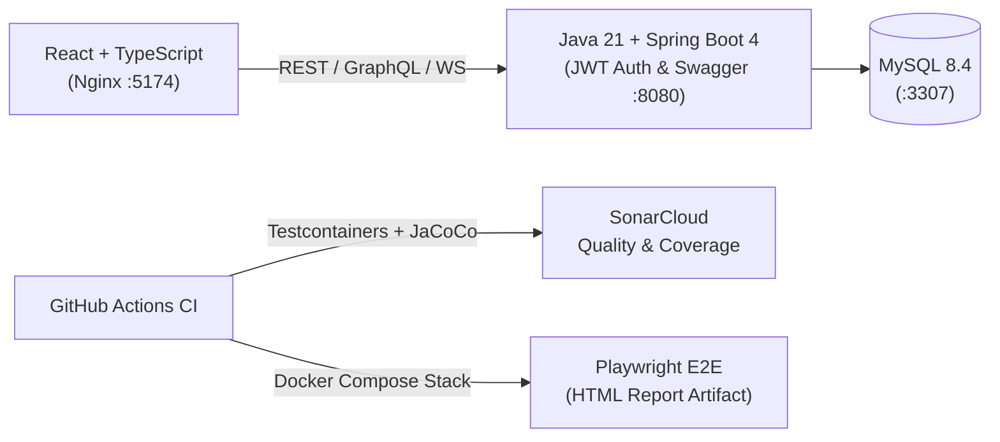
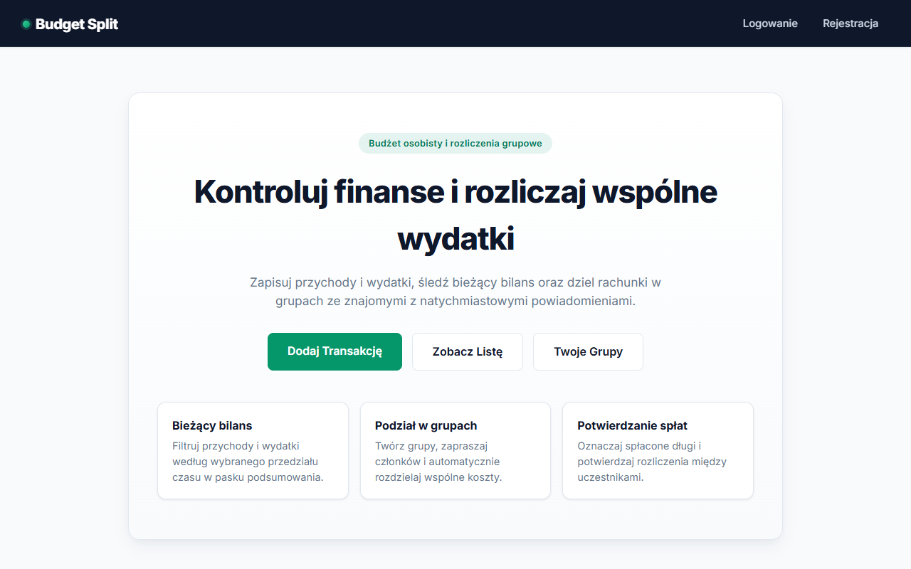
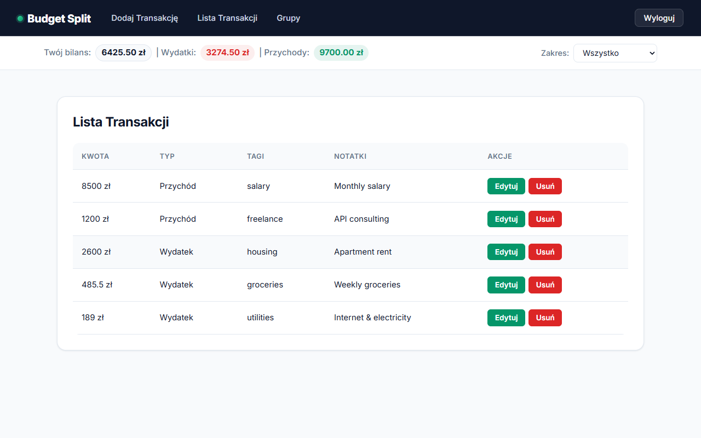
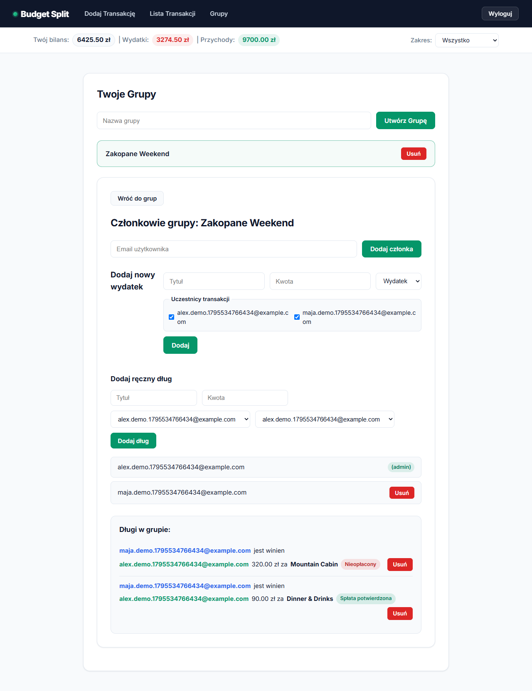
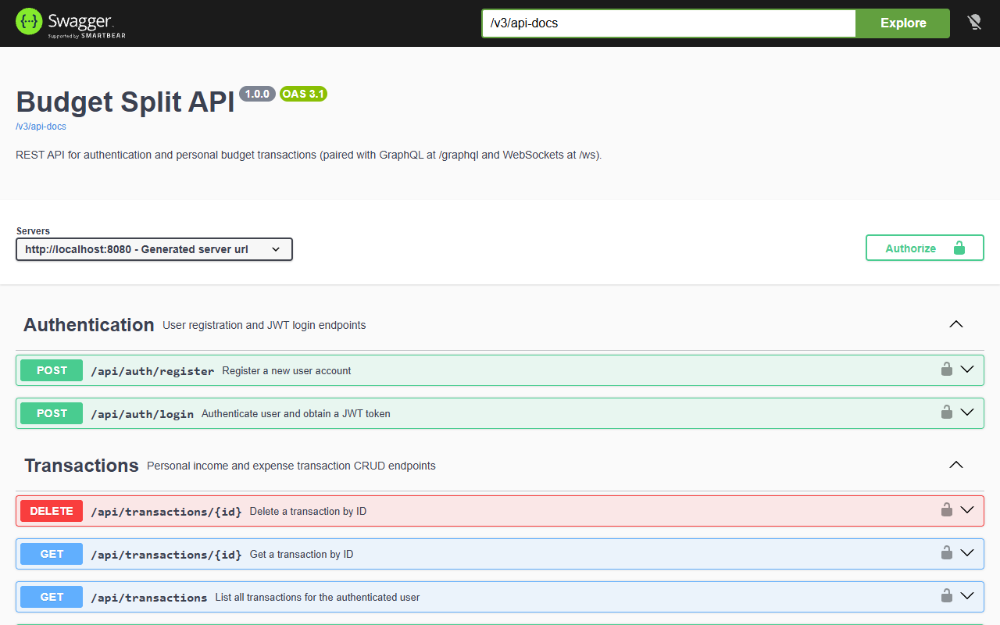

# Budget Split — Personal Budget & Group Debt Management

[](https://github.com/mpecek2077/budget-split/actions/workflows/sonar.yml)

Full-stack web application for tracking personal income/expenses and splitting shared group debts. Built with a **Java 21 / Spring Boot 4** backend (REST, GraphQL, WebSockets, OpenAPI/Swagger) and a **React / TypeScript** frontend, containerized with Docker Compose and backed by automated testing (**Testcontainers MySQL 8.4**, **Playwright E2E**, **JaCoCo**) and **SonarCloud** quality gates.

## Evolution & Engineering Upgrade

This repository started as an academic coursework project (`PASiR`) and was independently continued and refactored to production engineering and QA automation standards:

| Area | Original Academic Version | Production Continuation |
| :--- | :--- | :--- |
| **Backend Config** | Hardcoded DB credentials in `application.properties`, duplicate dependencies (`h2` in runtime, duplicate `websocket`) | Clean `pom.xml`, `backend/.env.example`, separated `dev` / `docker` / `test` Spring profiles |
| **API Documentation** | No REST documentation | **OpenAPI 3 & Swagger UI** (`springdoc-openapi`) with JWT Bearer auth support |
| **Backend Testing** | Basic service-level tests with `-DskipTests` in CI | Full HTTP REST + GraphQL + Security (401/403) integration suite running on both H2 and **Testcontainers MySQL 8.4** |
| **Code Coverage** | Not measured | **JaCoCo** XML coverage (`~82.5%` line coverage) integrated into **SonarCloud** |
| **E2E Testing** | Manual browser checks | Automated **Playwright** E2E suite covering auth, transactions, balance updates, group splits, and debt settlement |
| **CI/CD Pipeline** | Build-only scan (`mvn clean install -DskipTests`) | Full test execution (`mvnw clean verify`), frontend ESLint + Vite build, SonarCloud analysis, and containerized Playwright E2E job with HTML report artifacts |

## Architecture



## Screenshots

### Landing Page


### Personal Transactions & Live Balance Bar


### Group Expense Splitting & Debt Settlement


### Interactive REST API Documentation (Swagger UI)


## Key Features

- **Authentication & Security:** Stateless **JWT** authentication (`JwtAuthFilter`, HS512) with strict per-user transaction isolation and group ownership checks.
- **Personal Budget Tracking:** Full CRUD for income and expense transactions with time-range balance summaries (`BalanceBar`).
- **Group Expense Splitting & Settlements:** Create groups, invite members, split shared expenses, and track two-step debt settlements (debtor marks paid → creditor confirms).
- **Real-Time Notifications:** Live updates for group events over **WebSockets** (`WebSocketConfig`, `NotificationService`).
- **Hybrid API + OpenAPI Docs:** REST endpoints documented with **Swagger UI** (`/swagger-ui.html`) alongside a **GraphQL** API (`/graphql`) for groups, memberships, and debts.

## Test Pyramid

- **Service & Authorization Tests (`GroupDebtAuthorizationTests`):** Group membership rules, historical debt isolation, owner/member permissions.
- **HTTP Integration Tests (`ApiIntegrationTests` & `MysqlContainerIntegrationTests`):** End-to-end `MockMvc` tests for JWT auth, REST CRUD, validation, 401/403 boundaries, and GraphQL mutations/queries — executed against both H2 (`test` profile) and a real **MySQL 8.4** container via **Testcontainers**.
- **Browser E2E Tests (`frontend/e2e/budget-flow.spec.ts`):** Playwright tests verifying real user flows across registration, login, transactions, live balance bar, group creation, expense splitting, and debt confirmation.

## Tech Stack

- **Backend:** Java 21, Spring Boot 4, Spring Security (JWT), Spring for GraphQL, WebSockets, Springdoc OpenAPI, Maven, MySQL 8.4
- **Frontend:** React 19, TypeScript, Vite, SCSS Modules, Axios, React Hook Form
- **QA & DevOps:** JUnit 5, Testcontainers (MySQL 8.4), JaCoCo, Playwright, Docker Compose, Nginx, GitHub Actions, SonarCloud

## Quick Start (Docker Compose)

1. Create your local environment file from the template:
   ```bash
   cp backend/.env.example backend/.env
   ```
2. Build and start all services:
   ```bash
   docker compose up --build
   ```
3. Access the application:
   - **Frontend:** `http://localhost:5174`
   - **Backend API:** `http://localhost:8080`
   - **Swagger UI:** `http://localhost:8080/swagger-ui.html`
   - **OpenAPI JSON:** `http://localhost:8080/v3/api-docs`
   - **MySQL:** `localhost:3307`

## Running Tests

### Backend (Unit, Integration, Testcontainers MySQL & JaCoCo)

```bash
cd backend
./mvnw test
```

> When Docker is running, `MysqlContainerIntegrationTests` automatically spins up a `mysql:8.4` container. The JaCoCo report is generated at `backend/target/site/jacoco/index.html` and `jacoco.xml`.

### Frontend (Lint, Build & Playwright E2E)

```bash
cd frontend
npm ci
npm run lint
npm run build
```

With the stack running (`docker compose up -d --build`):

```bash
cd frontend
npx playwright install chromium
npm run test:e2e
```

## Project Structure

```text
budget-split/
├── .github/workflows/
│   └── sonar.yml              # CI/CD: Maven tests, JaCoCo, SonarCloud, Playwright E2E
├── backend/
│   ├── .env.example           # Environment template (no secrets)
│   ├── src/main/java/...      # REST & GraphQL controllers, services, security, OpenAPI config
│   ├── src/main/resources/    # Profiles (dev/docker) & GraphQL schema
│   ├── src/test/java/...      # Service, MockMvc & Testcontainers MySQL integration tests
│   └── Dockerfile
├── frontend/
│   ├── e2e/                   # Playwright E2E test specs
│   ├── src/                   # React pages, components, API clients & SCSS modules
│   ├── playwright.config.ts   # Playwright configuration & HTML/trace reporting
│   ├── nginx.conf             # Production Nginx reverse-proxy & static config
│   └── Dockerfile
├── docker-compose.yml         # Multi-container orchestration (MySQL, Spring Boot, Nginx)
└── sonar-project.properties   # SonarCloud & JaCoCo coverage configuration
```

## License

This project is licensed under the [MIT License](LICENSE).
